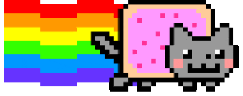
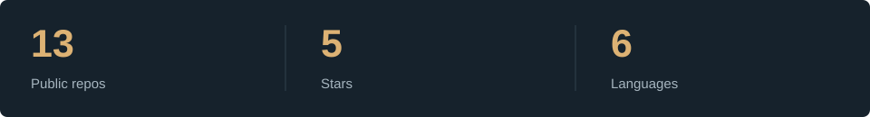
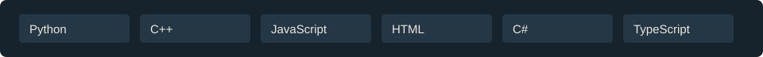

<h1>Hi, I'm Umi.</h1>

Building useful little things.

### Loadout

### Activity

### Selected projects

[UmiBridge](https://github.com/TDUmii/umi-bridge) · [QuietShare](https://github.com/TDUmii/QuietShare) · [AOE Web VN](https://github.com/TDUmii/aoe-web-browser-vn)

Public GitHub snapshot · Nov 5, 2026. Nyan Cat via [GIPHY](https://giphy.com/gifs/cat-pixel-art-nyan-7lsw8RenVcjCM).
