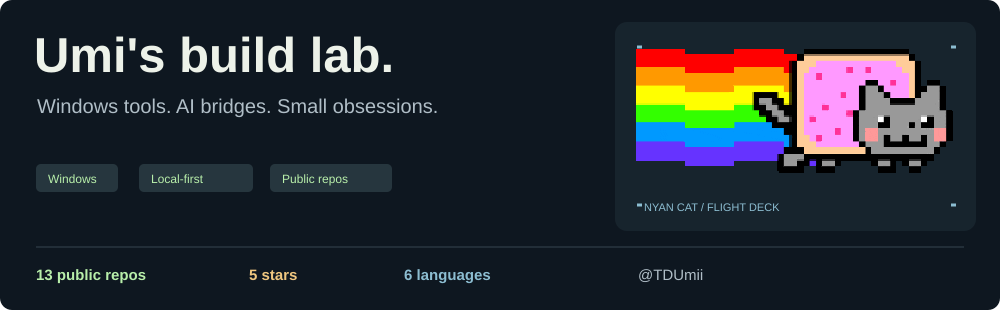
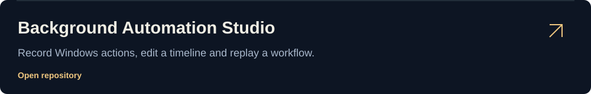
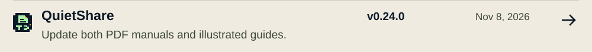
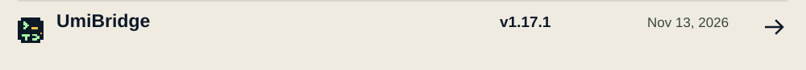
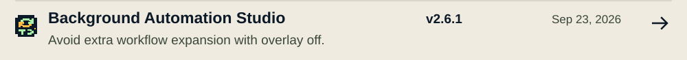
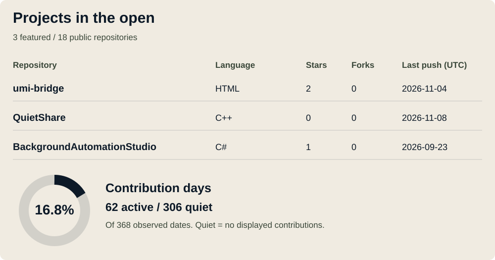
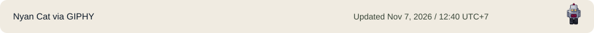

<picture><source media="(max-width: 600px)" srcset="https://raw.githubusercontent.com/TDUmii/TDUmii/f3050f8369083a981ea82df5014a8f9ab1c22ffc/assets/profile-hero-mobile.svg?v=3ee3dc9d74" /></picture>

<table><tr><td width="50%" valign="top"><a href="https://github.com/TDUmii/umi-bridge"><picture><source media="(max-width: 600px)" srcset="https://raw.githubusercontent.com/TDUmii/TDUmii/f3050f8369083a981ea82df5014a8f9ab1c22ffc/assets/project-row-bridge-mobile.svg?v=36244c183b" /></picture></a></td><td width="50%" valign="top"><a href="https://github.com/TDUmii/QuietShare"><picture><source media="(max-width: 600px)" srcset="https://raw.githubusercontent.com/TDUmii/TDUmii/f3050f8369083a981ea82df5014a8f9ab1c22ffc/assets/project-row-quietshare-mobile.svg?v=ae9ce1e998" /></picture></a></td></tr></table>

<a href="https://github.com/TDUmii/BackgroundAutomationStudio"><picture><source media="(max-width: 600px)" srcset="https://raw.githubusercontent.com/TDUmii/TDUmii/f3050f8369083a981ea82df5014a8f9ab1c22ffc/assets/project-row-automation-mobile.svg?v=192dfe65f2" /></picture></a>

<picture><source media="(max-width: 600px)" srcset="https://raw.githubusercontent.com/TDUmii/TDUmii/f3050f8369083a981ea82df5014a8f9ab1c22ffc/assets/shipped-heading-mobile.svg?v=333a174e95" /></picture> <a href="https://github.com/TDUmii/QuietShare/releases/tag/v0.24.0"><picture><source media="(max-width: 600px)" srcset="https://raw.githubusercontent.com/TDUmii/TDUmii/f3050f8369083a981ea82df5014a8f9ab1c22ffc/assets/shipped-quietshare-mobile.svg?v=4b679d56e5" /></picture></a> <a href="https://github.com/TDUmii/umi-bridge/releases/tag/v1.16.0"><picture><source media="(max-width: 600px)" srcset="https://raw.githubusercontent.com/TDUmii/TDUmii/f3050f8369083a981ea82df5014a8f9ab1c22ffc/assets/shipped-bridge-mobile.svg?v=8f46aceeae" /></picture></a> <a href="https://github.com/TDUmii/BackgroundAutomationStudio/releases/tag/v2.6.1"><picture><source media="(max-width: 600px)" srcset="https://raw.githubusercontent.com/TDUmii/TDUmii/f3050f8369083a981ea82df5014a8f9ab1c22ffc/assets/shipped-automation-mobile.svg?v=1373a1dd9b" /></picture></a>

<picture><source media="(max-width: 600px)" srcset="https://raw.githubusercontent.com/TDUmii/TDUmii/f3050f8369083a981ea82df5014a8f9ab1c22ffc/assets/activity-mobile.svg?v=3d735c42e1" /></picture>

<picture><source media="(max-width: 600px)" srcset="https://raw.githubusercontent.com/TDUmii/TDUmii/f3050f8369083a981ea82df5014a8f9ab1c22ffc/assets/insights-rhythm-mobile.svg?v=c2f5b0bf93" /></picture>

<picture><source media="(max-width: 600px)" srcset="https://raw.githubusercontent.com/TDUmii/TDUmii/f3050f8369083a981ea82df5014a8f9ab1c22ffc/assets/insights-projects-mobile.svg?v=635d3a7106" /></picture>

<picture><source media="(max-width: 600px)" srcset="https://raw.githubusercontent.com/TDUmii/TDUmii/f3050f8369083a981ea82df5014a8f9ab1c22ffc/assets/toolkit-compact-mobile.svg?v=af633f2d56" /></picture>

<table><tr><td width="50%"><a href="https://github.com/TDUmii/TDUmii/blob/main/docs/SOURCE-MAP.md"><picture><source media="(max-width: 600px)" srcset="https://raw.githubusercontent.com/TDUmii/TDUmii/f3050f8369083a981ea82df5014a8f9ab1c22ffc/assets/footer-lab-mobile.svg?v=c7a6f5b5af" /></picture></a></td><td width="50%"><a href="https://github.com/TDUmii?tab=repositories"><picture><source media="(max-width: 600px)" srcset="https://raw.githubusercontent.com/TDUmii/TDUmii/f3050f8369083a981ea82df5014a8f9ab1c22ffc/assets/footer-code-mobile.svg?v=ad844cb504" /></picture></a></td></tr></table>

<a href="https://giphy.com/gifs/cat-pixel-art-nyan-7lsw8RenVcjCM"><picture><source media="(max-width: 600px)" srcset="https://raw.githubusercontent.com/TDUmii/TDUmii/f3050f8369083a981ea82df5014a8f9ab1c22ffc/assets/footer-credit-mobile.svg?v=424e553620" /></picture></a>
