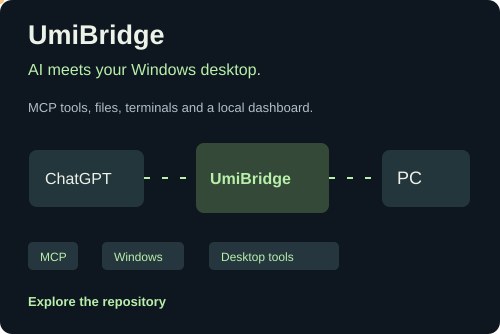
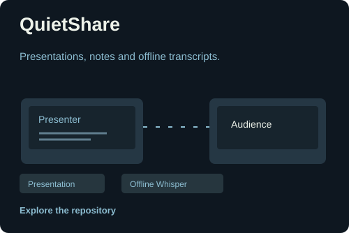
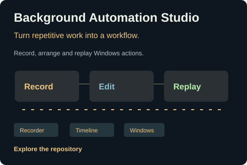
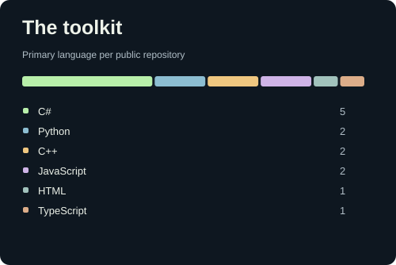

<a href="https://tdumii.github.io/TDUmii/"><picture><source media="(max-width: 600px)" srcset="https://raw.githubusercontent.com/TDUmii/TDUmii/main/assets/profile-hero-mobile.svg?v=c9f2588a8f" /></picture></a>

### Things I build

<table><tr><td width="50%"><a href="https://github.com/TDUmii/umi-bridge"><picture><source media="(max-width: 600px)" srcset="https://raw.githubusercontent.com/TDUmii/TDUmii/main/assets/project-bridge-mobile.svg?v=a3f8835c61" /></picture></a></td><td width="50%"><a href="https://github.com/TDUmii/QuietShare"><picture><source media="(max-width: 600px)" srcset="https://raw.githubusercontent.com/TDUmii/TDUmii/main/assets/project-quietshare-mobile.svg?v=6a8f112914" /></picture></a></td></tr><tr><td width="50%"><a href="https://github.com/TDUmii/BackgroundAutomationStudio"><picture><source media="(max-width: 600px)" srcset="https://raw.githubusercontent.com/TDUmii/TDUmii/main/assets/project-automation-mobile.svg?v=6412929a92" /></picture></a></td><td width="50%"><picture><source media="(max-width: 600px)" srcset="https://raw.githubusercontent.com/TDUmii/TDUmii/main/assets/toolkit-mobile.svg?v=b6568fc412" /></picture></td></tr></table>

<picture><source media="(max-width: 600px)" srcset="https://raw.githubusercontent.com/TDUmii/TDUmii/main/assets/activity-mobile.svg?v=fbb70c50bc" /></picture>

<a href="https://tdumii.github.io/TDUmii/"><picture><source media="(max-width: 600px)" srcset="https://raw.githubusercontent.com/TDUmii/TDUmii/main/assets/footer-lab-mobile.svg?v=4e03e9d30a" /></picture></a> <a href="https://github.com/TDUmii?tab=repositories"><picture><source media="(max-width: 600px)" srcset="https://raw.githubusercontent.com/TDUmii/TDUmii/main/assets/footer-code-mobile.svg?v=8cb5a8b93b" /></picture></a>

<a href="https://giphy.com/gifs/cat-pixel-art-nyan-7lsw8RenVcjCM"><picture><source media="(max-width: 600px)" srcset="https://raw.githubusercontent.com/TDUmii/TDUmii/main/assets/footer-credit-mobile.svg?v=ebc23a3245" /></picture></a>
